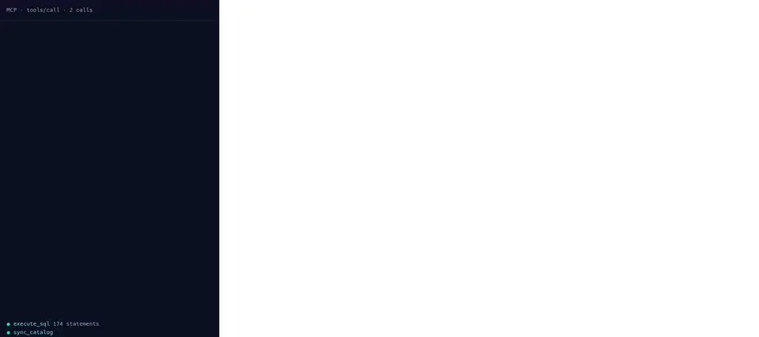
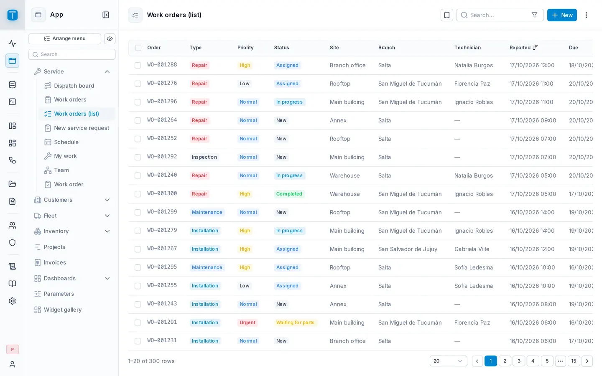
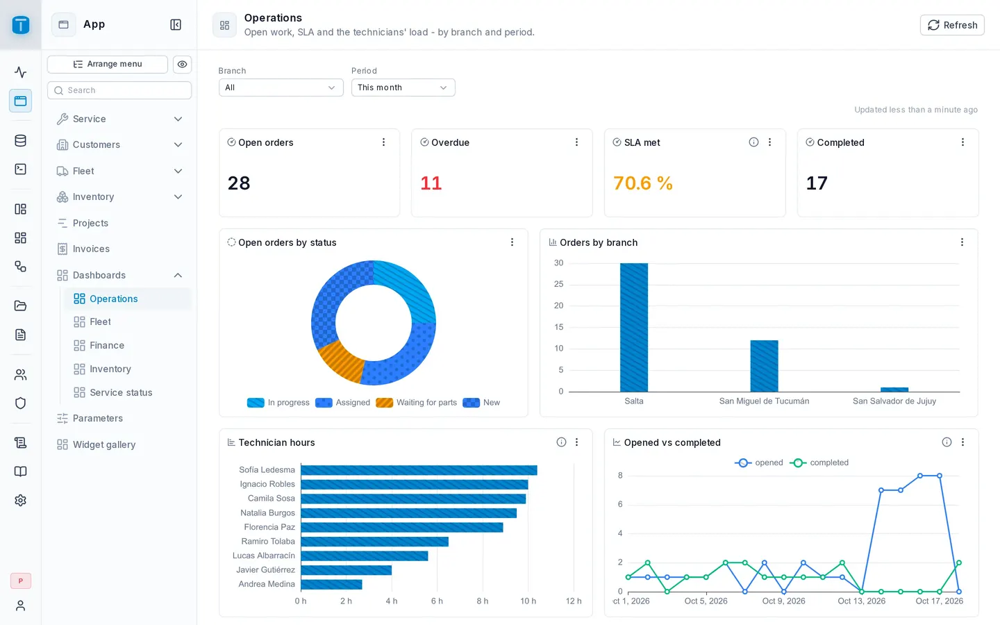
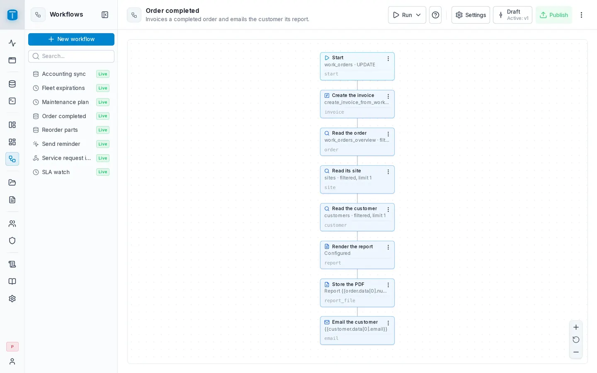
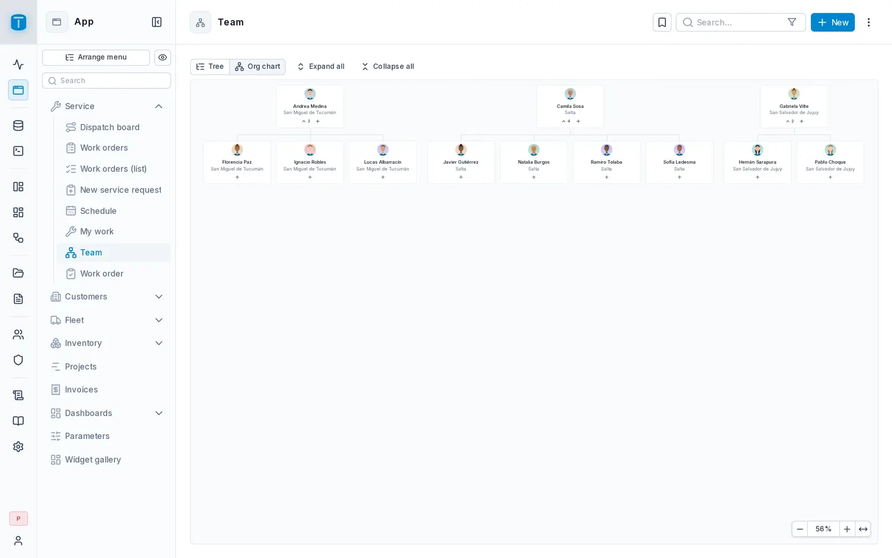
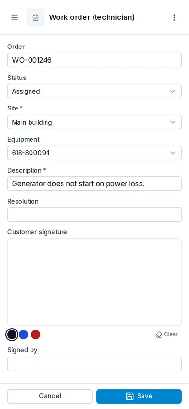
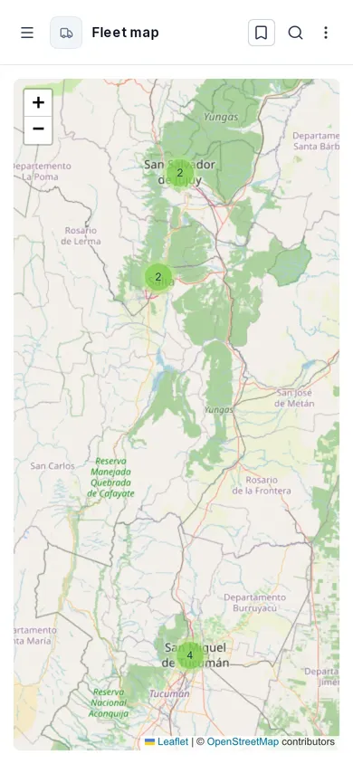
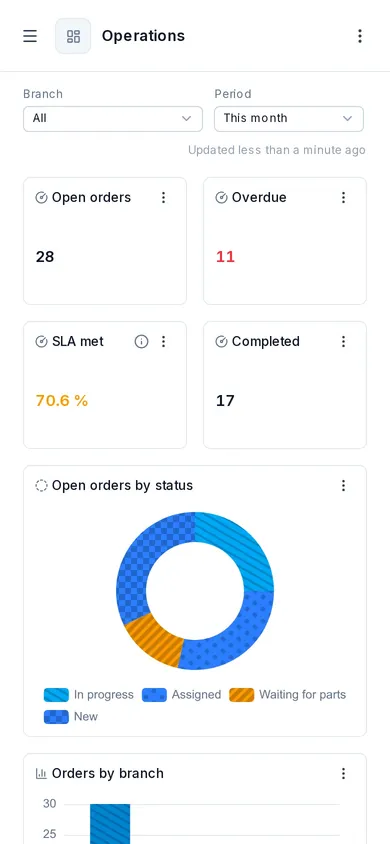

<p align="center">
  
</p>

<h1 align="center">TotalBase</h1>

<p align="center">
  <strong>From your PostgreSQL database to APIs, screens, dashboards and automations.</strong><br>
  Built by hand, or by describing it to an AI agent. PostgreSQL stays the authority.
</p>

<p align="center">
  <a href="LICENSE"></a>
  
  
</p>

<p align="center">
  <a href="https://totalbase.io">Website</a> ·
  <a href="https://docs.totalbase.io">Documentation</a> ·
  <a href="https://docs.totalbase.io/getting-started/installation">Installation</a> ·
  <a href="https://docs.totalbase.io/getting-started/quickstart-with-ai">Quickstart with AI</a>
</p>

<p align="center">
  
  <br>
  <sub>A field service application - tables, rules, roles, screens, dashboards and workflows - built through the MCP server: 354 calls, in under a minute.</sub>
</p>

---

TotalBase connects to a PostgreSQL database, new or existing, and gives you on top of it:

- **A REST Data API** over the tables, views and functions you choose to expose: filters, relations, aggregates, nested writes and transactions, with a generated OpenAPI document.
- **Users, roles and permissions** down to rows and fields - row filters, field grants and payload checks, compiled into the SQL PostgreSQL runs; sign-in with a password or an OAuth/OIDC provider, and two-factor authentication with an authenticator app.
- **DataViews**: screens over your data - tables, cards, kanban boards, calendars, Gantt charts, maps, trees and org charts, forms and custom pages - that people use in the App on a desktop, a tablet or a phone.
- **Dashboards** built from SQL queries, which you can also embed in another site.
- **Workflows** started by a data change, a schedule, a webhook or a person: emails, PDFs, HTTP calls, code.
- **An audit log** of every write, and an **MCP server** so an AI agent builds and runs all of the above under the same permissions as a person.

<table>
  <tr>
    <td width="50%">
      <picture>
        <source media="(prefers-color-scheme: dark)" srcset=".github/readme/type-table-dark.webp">
        
      </picture>
      <p align="center"><sub>Work orders in the App - also a kanban, a calendar or a map</sub></p>
    </td>
    <td width="50%">
      <picture>
        <source media="(prefers-color-scheme: dark)" srcset=".github/readme/build-with-ai-dashboard-dark.webp">
        
      </picture>
      <p align="center"><sub>A dashboard from SQL queries</sub></p>
    </td>
  </tr>
  <tr>
    <td width="50%">
      <picture>
        <source media="(prefers-color-scheme: dark)" srcset=".github/readme/workflow-editor-dark.webp">
        
      </picture>
      <p align="center"><sub>A workflow, step by step</sub></p>
    </td>
    <td width="50%">
      <picture>
        <source media="(prefers-color-scheme: dark)" srcset=".github/readme/type-tree-org-dark.webp">
        
      </picture>
      <p align="center"><sub>An org chart, from a table that points at itself</sub></p>
    </td>
  </tr>
</table>

<p align="center">
  <picture>
    <source media="(prefers-color-scheme: dark)" srcset=".github/readme/mobile-work-order-dark.webp">
    
  </picture>
  &nbsp;
  <picture>
    <source media="(prefers-color-scheme: dark)" srcset=".github/readme/mobile-map-dark.webp">
    
  </picture>
  &nbsp;
  <picture>
    <source media="(prefers-color-scheme: dark)" srcset=".github/readme/mobile-dashboard-dark.webp">
    
  </picture>
  <br>
  <sub>Made for every screen: the same App on a phone, with nothing to build twice.</sub>
</p>

## Two ways to build

**By hand**, in the admin: create a table, give its statuses colors, make a screen of it in one step, choose who opens it, and see the App as one of them before anyone does. [Quickstart by hand](https://docs.totalbase.io/getting-started/quickstart-by-hand).

**With an AI agent**: connect Claude Code, or any MCP client, and describe what you need.

```text
Build a field service application: customers and their sites, work orders by status and priority,
technicians who see only their own orders, a kanban for dispatchers and a dashboard of the overdue ones.
```

The agent creates the tables and their rules, the roles and permissions, the screens and the dashboard, and checks its own work for what would still stop a role (`check_app`). [Quickstart with AI](https://docs.totalbase.io/getting-started/quickstart-with-ai).

Either way the result is the same: ordinary PostgreSQL tables and objects you open and change in the admin - not generated code to maintain.

## Why TotalBase

- **PostgreSQL decides.** Constraints, triggers, functions and types keep deciding; TotalBase shows their messages instead of re-implementing them. Anything you change with `psql` or a migration tool shows up in TotalBase too.
- **Nothing is exposed until you say so.** A new table is hidden; every read and write needs a grant, down to the row and the field.
- **One instance, one port, no extra infrastructure.** No Redis, no queue, no second database: the API, the admin, the App, the workflows and the MCP server run in one container. When one isn't enough, run several behind a load balancer: PostgreSQL carries what they share.

## Status

**Beta** (`0.1.0-beta.3`). TotalBase runs and is tested on PostgreSQL 15 to 18, and its data model is final from this release on: a beta database upgrades in place. APIs may still change before 1.0, and every change is in the [release notes](https://github.com/totalbase-io/totalbase/releases).

The image is `totalbase/totalbase` on [Docker Hub](https://hub.docker.com/r/totalbase/totalbase), for amd64 and arm64: `:beta` follows the beta, `:0.1.0-beta.3` pins this version.

## Requirements

- **PostgreSQL 15, 16, 17 or 18** (18 recommended for new installations).
- **A database role that is not a superuser.** TotalBase can do exactly what its role can do, and nothing more.
- **Docker**, or any container runtime.

## Quick start

TotalBase runs as one container, on one port: the admin at `/admin/`, the Data API at `/api/`, the MCP server at `/mcp`.

**Against a PostgreSQL you already run**, the connection is all it needs:

```bash
docker run -d --name totalbase -p 3050:3050 \
  -v totalbase-data:/var/lib/totalbase \
  -e POSTGRES_HOST=your-server -e POSTGRES_DB=acme \
  -e POSTGRES_USER=totalbase -e POSTGRES_PASSWORD=... \
  totalbase/totalbase:beta

docker logs totalbase   # the link that creates the first administrator
```

Open the link and create your administrator. The first start generates the master key, which encrypts stored secrets, into the data volume (`/var/lib/totalbase/master.key`); keep a copy outside the database - a full recovery needs both a PostgreSQL backup and the key.

<details>
<summary><strong>From scratch, with PostgreSQL included</strong> (Docker Compose)</summary>

```yaml
# docker-compose.yml - PostgreSQL 18 and TotalBase together
services:
  postgres:
    image: postgres:18
    environment:
      POSTGRES_PASSWORD: ${POSTGRES_SUPERUSER_PASSWORD}
      TOTALBASE_DB_PASSWORD: ${TOTALBASE_DB_PASSWORD}
    volumes:
      - pgdata:/var/lib/postgresql
      - ./postgres-init:/docker-entrypoint-initdb.d:ro
    healthcheck:
      test: ["CMD-SHELL", "pg_isready -U postgres -d acme"]
      interval: 5s
      retries: 20

  totalbase:
    image: totalbase/totalbase:beta
    depends_on:
      postgres:
        condition: service_healthy
    environment:
      POSTGRES_HOST: postgres
      POSTGRES_DB: acme
      POSTGRES_USER: totalbase
      POSTGRES_PASSWORD: ${TOTALBASE_DB_PASSWORD}
    volumes:
      - data:/var/lib/totalbase   # uploaded files and the generated master key
    ports:
      - "3050:3050"

volumes:
  pgdata:
  data:
```

```bash
# postgres-init/01-totalbase.sh - a non-superuser role and the database it owns
#!/bin/bash
set -euo pipefail
psql -v ON_ERROR_STOP=1 --username "$POSTGRES_USER" --dbname postgres <<EOSQL
CREATE ROLE totalbase LOGIN PASSWORD '${TOTALBASE_DB_PASSWORD}';
CREATE DATABASE acme OWNER totalbase;
EOSQL
```

Put the two passwords in an `.env` file beside it, run `docker compose up -d`, and `docker compose logs totalbase` shows the link that creates the first administrator.

</details>

Every setting, TLS behind a proxy and backups: [Installation](https://docs.totalbase.io/getting-started/installation) and [Operations](https://docs.totalbase.io/operations/deployment).

## Building from source

```bash
pnpm install
pnpm -r run build
docker build --target server -t totalbase:local .
```

For development, `pnpm dev` runs the server and the admin together on one origin (`http://localhost:3050/admin/`); copy `.env.example` to `.env` first. See [CONTRIBUTING.md](CONTRIBUTING.md).

## Contributing

Issues and pull requests are welcome. Read [CONTRIBUTING.md](CONTRIBUTING.md) first: it has the project's rules, and a contribution needs the [Contributor License Agreement](CLA.md), signed once from the pull request.

Security problems go privately to **security@totalbase.io**, as [SECURITY.md](SECURITY.md) says - never in a public issue. Anything else: **hello@totalbase.io**.

## License

[Apache License 2.0](LICENSE). Copyright 2026 César Echazú and the TotalBase contributors.
